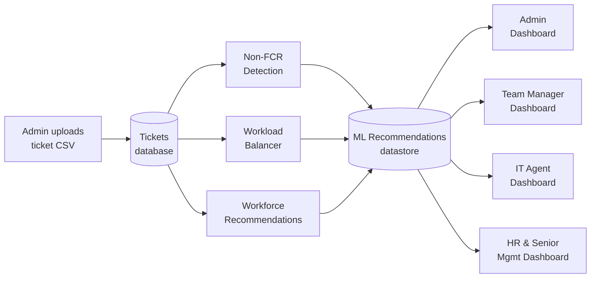

# 🧠 Work-Wise

### An Intelligent Multi-Level Decision Support System Using Machine Learning Forecasting, Performance Diagnostics, and Workload Optimization for ITSM Operations

*Capstone project · BS Information Technology (Business Analytics) · FEU Alabang · July 2026*

---

## 📑 Table of Contents

1. [At a Glance](#-at-a-glance)
2. [The Problem](#-the-problem)
3. [What Work-Wise Does](#-what-work-wise-does)
   - [One System, Four Views](#one-system-four-views)
   - [Core Analytics Modules](#core-analytics-modules)
   - [Machine Learning Models](#machine-learning-models)
4. [System Architecture](#-system-architecture)
5. [Impact and Business Implications](#-impact-and-business-implications)
6. [Evaluation Results](#-evaluation-results)
7. [Skills Demonstrated](#-skills-demonstrated)
8. [Tech Stack](#-tech-stack)
9. [Data Format](#-data-format)
10. [Database Design](#-database-design)
11. [Development Methodology and Testing](#-development-methodology-and-testing)
12. [Limitations](#-limitations)
13. [Roadmap](#-roadmap)
14. [Team](#-team)
15. [Citation](#-citation)

---

## 🔎 At a Glance

| | |
|---|---|
| **Project** | Work-Wise |
| **Type** | Web-based, multi-level Decision Support System (DSS) |
| **Domain** | IT Service Management (ITSM) / IT help desk operations |
| **Commissioned by** | A professional from **Cognizant**, a global provider of IT help-desk support |
| **Core idea** | Combine **predictive**, **diagnostic**, and **prescriptive** analytics in one platform so ITSM managers can plan staffing, catch service problems early, and balance workloads |
| **Key models** | ARIMA (ticket-volume forecasting) · Logistic Regression (First Call Resolution risk) · Regression (SLA and staffing capacity) |
| **Users** | Admin · ITSM Team Managers · IT Support Agents · HR & Senior Management |
| **Status** | Working academic prototype, evaluated by 30 respondents |
| **Data** | Simulated ticket data (the client could only provide sample fields and values) |

**In one sentence:** Work-Wise turns raw IT support ticket data into forecasts, performance scorecards, risk flags, and staffing recommendations, delivered through dashboards tailored to each person's role.

---

## ⚠️ The Problem

Modern ITSM teams handle a high volume of tickets under strict **Service-Level Agreements (SLAs)**. Even so, many still rely on manual processes and manager intuition. The project identifies three recurring problems:

1. **Unpredictable ticket volumes.** Without forecasts, staffing decisions (how many agents to hire or schedule) are reactive and imprecise, which leads to understaffing at peaks and idle capacity at lulls.
2. **Uneven performance across teams and agents.** Without defined KPIs, managers can't easily tell which teams need training, support, or workload reassignment. The result is long resolution times, inconsistent service quality, and SLA violations.
3. **Costly Non-FCR tickets.** Tickets that are *not* resolved on the first contact (Non-FCR) raise costs, increase workload, and lower customer satisfaction. They are rarely spotted early.

Existing tools tend to be standalone dashboards or manual spreadsheets. Each solves one problem in isolation and gives no guidance on *what to do next*. Work-Wise integrates all three concerns in a single system.

---

## ⚙️ What Work-Wise Does

### One System, Four Views

Work-Wise is **multi-level**. It follows the escalation structure of an ITSM organisation, so each level sees the information relevant to its decisions.

| Role | What they see and do |
|---|---|
| 🛠️ **Admin** | Manages user accounts, roles, and permissions. Uploads and maintains ticket datasets. Sees overall KPIs (SLA compliance, FCR rate, median resolution time, reopen rate), weekly actual-vs-predicted ticket volume, and priority distribution. Can view any user's or team's dashboard. |
| 👥 **ITSM Team Manager** | Monitors team SLA, FCR, and active tickets. Sees flagged high-risk tickets, problem areas, workload balance, and staffing needs, and decides on task distribution, coaching, and support. |
| 🎧 **IT Support Agent** | Sees assigned tasks, open and resolved tickets, high-priority items, and personal performance. Can filter tasks by category and priority. |
| 📊 **HR & Senior Management** | Sees aggregated organisational performance, workload trends, top-performing teams, teams needing support, and forecast-driven hiring and workforce recommendations. |

Supported teams in the prototype: **Software, Network, Security, Hardware, and Service Desk.**

### Core Analytics Modules

#### 1. 📈 Performance Monitoring (Diagnostic)
A general performance dashboard consolidates the operational health indicators:
- **SLA compliance**
- **First Call Resolution (FCR) rate**
- **Median / average resolution time**
- **Reopen rate**
- **Assignment-group performance comparison** (SLA vs. FCR per team)

Managers can see *which* group is falling short and *where* to intervene.

#### 2. 🚨 Non-FCR Risk Detector (Diagnostic + Prescriptive)
Detects tickets likely to fail first-contact resolution and explains why.
- Computes FCR rates **by ticket category** and **by assigned agent**
- Distinguishes **systemic issues** (many agents struggle with a category) from **individual issues** (one agent struggles with one category)
- Assigns each ticket a **risk score**
- Recommends targeted actions: *monitoring, standard handling, training, reassignment, or escalation*
- Surfaces top-performing and underperforming agents and categories

#### 3. 👷 Staffing Intelligence (Predictive + Prescriptive)
Answers the question *"Do we have enough people for the demand we expect?"*
- **Forecasts weekly ticket volume**, capturing seasonal demand
- Converts staffing capacity into **agent-to-ticket ratios**
- Estimates whether current staffing can sustain the **target SLA compliance**
- Compares **current vs. recommended staffing** per team
- Flags **workforce gaps and priority hiring needs**
- Supports **workload redistribution** during forecasted high-volume periods

### Machine Learning Models

| Module | Model | Inputs | Output |
|---|---|---|---|
| **Ticket volume forecasting** | **ARIMA** (SARIMA considered for seasonality) | Historical weekly ticket counts | Forecasted ticket volume |
| **Non-FCR detection** | **Logistic Regression** | Ticket category, assigned employee, FCR status | Probability that a ticket will not be resolved on first contact |
| **Staffing and SLA estimation** | **Regression** | Forecasted volume, staffing levels, historical SLA compliance | Estimated capacity needed to meet the SLA threshold |
| **Scenario testing** | **Simulation** | Staffing scenarios against forecasted demand | Hiring and redistribution options |

**Planned evaluation design:**

| Model | Split | Metrics |
|---|---|---|
| Non-FCR Detector | 70/30, stratified (keeps FCR/Non-FCR balance) | Precision, Recall, F1, ROC-AUC |
| Staffing Intelligence | 70/30 on historical ticket data | MAE, RMSE for forecasts; Precision, Recall, F1 for workforce-sufficiency predictions |

A **feedback mechanism** is part of the design: updated data and management decisions are meant to refine future analyses. A forecast table stores recommendations so they can later be compared with actual outcomes and the system's accuracy audited.

---

## 🏗️ System Architecture

**How data flows:**

1. The **Admin** uploads ticket data (CSV), which is validated and stored.
2. Three ML processes run on the data: **Non-FCR Detection**, **Workload Balancer**, and **Workforce Recommendations**.
3. Their outputs are consolidated in a **Machine Learning Recommendations** datastore, the central repository of prescriptive analytics.
4. Results are distributed to the four role-based dashboards, each filtered to what that role needs.

**Input → Process → Output:**
- **Input:** historical IT support ticket data, cleaned and feature-engineered
- **Process:** ML forecasting, KPI evaluation, Non-FCR risk detection
- **Output:** the Work-Wise decision support system, with a feedback loop for continuous refinement

---

## 💼 Impact and Business Implications

**What the system is designed to improve**

| Business concern | How Work-Wise addresses it |
|---|---|
| **SLA breaches** | Early warning on workload spikes and at-risk tickets; SLA monitoring per team |
| **Staffing decisions** | Forecast-driven, evidence-based hiring and redistribution instead of intuition |
| **First Call Resolution** | Root-cause diagnostics (category vs. agent) with specific interventions |
| **Agent burnout** | Better workload distribution during peak periods |
| **Management visibility** | Role-based, explainable dashboards across organisational levels |
| **Customer satisfaction** | Faster resolution and fewer repeat contacts, expected to follow from better FCR and SLA performance |

**Who benefits**
- **Client commissioner:** visibility into operations and data-backed staffing decisions
- **Cognizant:** the system could scale to company-level ITSM operations if proposed to management
- **IT operations managers, team leaders:** proactive workforce planning
- **HR / talent acquisition:** forecast-supported hiring justification
- **IT support agents:** more balanced workloads
- **Callers / requesters:** faster, more consistent service
- **Researchers and students:** a real-world case of applied DSS in ITSM

**Cost.** The system was donated to the client under the project agreement. The only implementation cost, shouldered by the researchers, was about **₱8,961.62** (web hosting plus domain name).

> **Honest framing:** the evaluation shows that users find the system useful for *monitoring and decision-making*. A *measurable* improvement in SLA compliance and efficiency has **not yet been demonstrated** (see [Limitations](#-limitations)).

---

## 📊 Evaluation Results

The system was evaluated with a post-survey based on the **FURPS** model (Functionality, Usability, Reliability, Performance, Supportability), using a 5-point Likert scale. The survey was distributed online and had **30 respondents**, selected by purposive sampling:

- **20 organisational stakeholders**: Hardware, Network, Security, Service Desk, Software teams, HR and managers
- **10 technical evaluators**: IT specialists, data analysts, UI specialists, IT service managers

**Organisational stakeholders (weighted mean, 1–5)**

| Dimension | Mean | Interpretation |
|---|---|---|
| Effectiveness & Performance | 3.90 | Agree |
| Usability & Reliability | 4.06 | Agree |
| Overall Impact | 3.73 | Agree |
| **Overall** | **3.90** | **Agree** |

**Technical evaluators (weighted mean, 1–5)**

| Dimension | Mean | Interpretation |
|---|---|---|
| Effectiveness & Performance | 3.84 | Agree |
| Usability & Reliability | 3.90 | Agree |
| Functionality & Analytical Capability | 3.76 | Agree |
| Supportability & Overall Technical Impact | 4.17 | Agree |
| **Overall** | **3.92** | **Agree** |

**Highlights**
- Highest-rated stakeholder items: predictive forecasting usefulness (**4.05**) and support for staffing and workload decisions (**4.05**).
- Highest-rated technical item: the system is practical for real-world ITSM operations (**4.30**).
- Survey reliability was checked with **Cronbach's Alpha** (threshold ≥ 0.70). The first stakeholder dimension reported α = 0.82, and the remaining dimensions were reported as exceeding 0.70.

**Where results were cautious**
- Stakeholders were more reserved about whether the system improves overall **operational efficiency** (item mean 3.35, which falls in the *Neutral* band).
- Technical evaluators were **neutral** (3.00; all 10 chose "Neutral") on whether the system delivers **measurable improvements in SLA compliance and efficiency**.

**Functional testing:** the documented test cases (user management, roles and permissions, password change, ticket filtering, CSV import with column validation, and role-based dashboard access) all passed.

---

## 🎯 Skills Demonstrated

**Data & Machine Learning**
- Time-series forecasting (ARIMA / SARIMA)
- Binary classification with Logistic Regression
- Regression for capacity and SLA estimation
- Feature engineering from operational ticket data
- Stratified train/test splitting and model evaluation (Precision, Recall, F1, ROC-AUC, MAE, RMSE)
- Scenario simulation for staffing decisions

**Business Analytics**
- KPI design (SLA compliance, FCR, resolution time, reopen rate)
- Predictive, diagnostic, and prescriptive analytics
- Workforce and capacity planning
- Translating analytics into actionable recommendations

**Software Engineering**
- Full-stack web application development
- Relational database design (normalised ERD)
- Role-based access control and authentication
- CSV ingestion with validation
- Agile-Scrum delivery with client feedback loops
- Unit, integration, performance, security, and stress testing plan

**Research & Communication**
- Requirements and feasibility analysis (operational, technical, economic, schedule)
- Survey design and statistical treatment (frequency, weighted mean, Cronbach's Alpha)
- Client-facing documentation and stakeholder analysis

---

## 🧰 Tech Stack

| Layer | Technologies |
|---|---|
| **Frontend** | HTML, CSS, JavaScript, Bootstrap, Tailwind, Chart.js |
| **Backend** | PHP (CodeIgniter) |
| **ML / Analytics** | Python, Scikit-learn, Pandas, NumPy (XGBoost, TensorFlow/PyTorch listed as optional extensions) |
| **Database** | PostgreSQL (Render Postgres); MySQL / phpMyAdmin listed for the deployment stack |
| **Hosting** | Render (Free tier for prototype; Standard plan recommended for production) |
| **Design** | Figma / Adobe XD |
| **Dev tools** | VS Code / PyCharm, GitHub, XAMPP, Docker, Jupyter Notebook, Node.js |
| **Evaluation tooling** | Google Forms, MS Excel / SPSS / Pandas |

**Minimum development environment:** Python 3.9+, 8 GB RAM, 50 GB storage, Windows 10 64-bit (or equivalent).

---

## 🗂️ Data Format

Ticket data is imported by the Admin as a **CSV file**. The system validates the file before processing.

**Required columns**

| Column | Description |
|---|---|
| `Ticket Number` | Unique ticket identifier |
| `Priority` | Critical / High / Medium / Low |
| `Category` | Ticket category |
| `FCR` | Whether the ticket was resolved on first contact |
| `Created` | Ticket creation date |
| `Status` | e.g. New, In Progress, Resolved |
| `Made SLA` | Whether the SLA target was met |

A file with missing required columns is rejected with a validation error. **Optional fields** (such as resolution date, assignment group, assigned agent, reopen count, and reassignment count) enable deeper analysis.

> 💡 Forecast and diagnostic accuracy depend directly on the completeness and quality of the uploaded data.

---

## 🧱 Database Design

The ERD is fully normalised and covers:

- **Core:** `Tickets` (creation and resolution dates, duration, reopen and reassignment counts, SLA compliance, FCR)
- **People & access:** `Users` (requesters, assignees, closers), `Roles`, `Assignment Groups`
- **Classification lookups:** `Priority`, `Impact`, `Urgency`, `Status`, `Sub-Status`, `Category`, `Subcategory`, `Channel`, `Source`, `Configuration Items`, `SLA`
- **Feedback:** `Survey` (post-resolution feedback linked to tickets)
- **Auditing:** a `Forecast` table that stores recommendations so they can be compared with actual outcomes

---

## 🔄 Development Methodology and Testing

**Methodology.** Iterative and incremental, using **Agile-Scrum** sprints. Working modules such as ticketing, KPI monitoring, and dashboards were delivered in increments, with regular progress checks and feedback from the client.

**Testing approach**
1. **Unit tests**: ticket classification, KPI analytics, dashboard rendering
2. **Integration tests**: backend (PHP/CodeIgniter, database, Python) ↔ frontend (Chart.js dashboards)
3. **System tests** against functional and non-functional requirements
4. **Performance, security, and stress tests** covering response time, authentication, data integrity, and heavy-traffic behaviour

---

## 🚧 Limitations

- **Simulated data.** The client could only supply sample fields and values, so the prototype ran on generated data in a controlled environment. Real-world performance is unproven.
- **No live data feed.** Data enters through **periodic manual CSV uploads**. There is no real-time streaming or continuous monitoring.
- **Single-team scope.** The system is confined to the commissioner's team unless it is proposed for wider adoption within Cognizant.
- **Data-dependent accuracy.** Forecast and diagnostic quality depend on data completeness and reliability.
- **Impact not yet proven.** Stakeholders and technical evaluators were cautious about measurable gains in efficiency and SLA compliance.
- **Small evaluation sample.** 30 respondents, purposively sampled, measuring *perceptions* rather than operational outcomes.

---

## 🗺️ Roadmap

- [ ] **Real-time data integration**: connect directly to live ticket sources so analytics run on current data
- [ ] **Broader deployment**: pilot across larger Cognizant teams or similar ITSM organisations to test scalability
- [ ] **Automated data quality pipelines**: validation and cleansing to remove duplicates, inconsistencies, and outliers
- [ ] **Continuous ML monitoring and retraining**: refresh models with new data, benchmark against operational outcomes, and apply **drift detection**
- [ ] **Outcome-based validation**: measure real changes in SLA compliance, FCR, and resolution time after adoption
- [ ] **ITSM tool integrations**: extend the API and integration points to connect with other ITSM platforms

---

## 👥 Team

**Developers**
- Jorge Jesse Jr. M. Cabinian
- Matthew Nicolai D. Competente
- Jacob Riley D. Fernandez
- Mathew G. Maranan

**Capstone Adviser:** Milagros V. Ortega, MIT
**Course Adviser:** Armando D. Delmundo, PhD
**Panel:** Renjun A. Orain, DIT (Head Panelist) · Jennifer V. Diaz, MBA · Merlin A. Marfa, MIT

**Institution:** FEU Alabang, Bachelor of Science in Information Technology with Specialization in Business Analytics

---

© 2026 Cabinian, Competente, Fernandez, and Maranan. All rights reserved.
The authors grant FEU Alabang permission to reproduce and distribute the manuscript.

